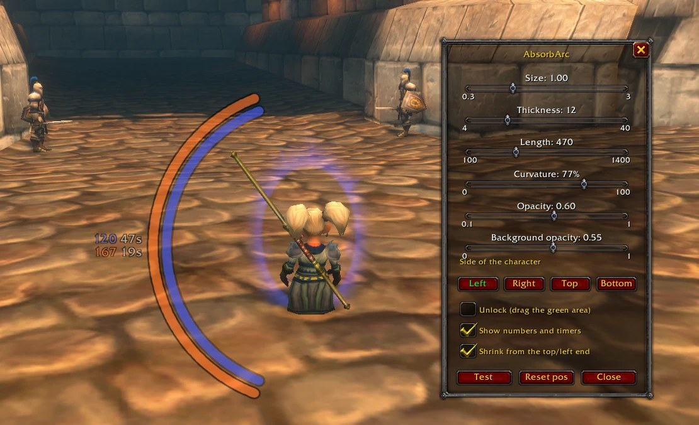

# AbsorbArc for WoW: Forever

**See how much your shield has left, right next to your character.**

AbsorbArc draws your absorb shields as arcs around your character. Each arc
shrinks as the shield soaks up damage and disappears when it breaks or runs out,
with the remaining amount and the seconds left next to it.

- one arc per shield, each in its own color, side by side
- works in combat, and notices a **Power Word: Shield from a priest**
- adjustable size, thickness, length, curvature (straight bar to half circle),
  side, opacity and position
- settings saved per character

For **WoW: Forever** (client 1.60.1). Version **0.5.2**.

## Shields

| Mage | Priest | Warlock |
|---|---|---|
| Ice Barrier, Mana Shield, Fire Ward, Frost Ward | Power Word: Shield (also from others) | Shadow Ward, Sacrifice |

All ranks are recognized.

## Usage

`/aa` opens the settings. While they are open, three preview arcs show every
change right away; **Unlock** lets you drag the arcs to any position.

| Command | Effect |
|---|---|
| `/aa` | open or close the settings |
| `/aa test` | 12-second demo |
| `/aa unlock`, `/aa lock` | drag mode on or off |
| `/aa side left\|right\|top\|bottom` | side of the character |
| `/aa scale`, `alpha`, `length`, `curve`, `pos <x> <y>` | same as the sliders |
| `/aa style square` | if the round dots look wrong |
| `/aa smooth` | draw each arc as one layer (default on); turn off if arcs look cut off |
| `/aa status`, `/aa debug` | show what AbsorbArc tracks and decides |

## How it works

WoW: Forever hides your buffs from addons during combat and shows your total
absorb only as a value addons can display but not calculate with. So:

- **Out of combat** the remaining amount is read exactly from the buff, and the
  full size of each shield you cast is remembered.
- **In combat** your own shield casts are still visible; the amount left is the
  game's total absorb, drawn by the game into the arc. At 0 the arc disappears.
- **A priest's shield** in combat is recognized when your absorb changes at the
  same moment a new buff appears.
- **Mana Shield** has no readable amount at all; it is counted down from the mana
  you lose (2 mana per point absorbed).

**Limits:** with several shields up in combat each arc shows the total (marked
`~`); a broken shield keeps its arc until its timer ends if another shield is
still up; mana lost to an enemy drain counts as absorbed by Mana Shield. Shield
sizes come from English spell descriptions; other languages work after you have
cast a shield once out of combat.

## License

[MIT](LICENSE)
